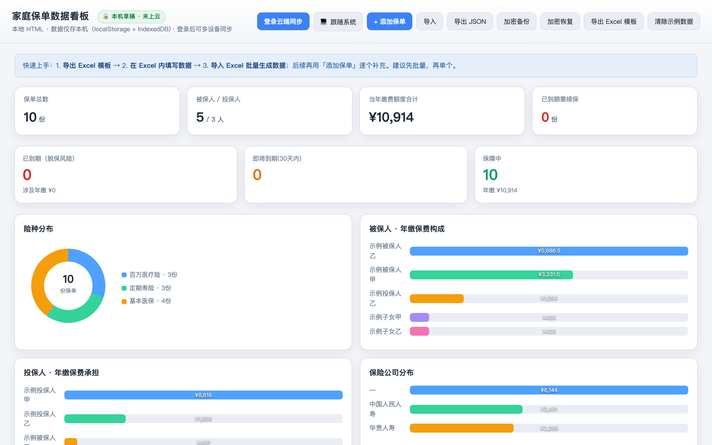

# Family Insurance Dashboard

One table that finally makes the family's insurance clear: who is covered, whether coverage is enough, which policy expires soon, and how much this year costs.

[简体中文](./README.md)



## What it is

A single-page dashboard that runs **on your own machine**. Policy data lives in your browser (localStorage / IndexedDB), with optional sync through your own Supabase project. No sign-up, no third-party service, and no policy data leaves your household.

It fits people whose policies are scattered across drawers and a few spreadsheets, who want to know "what do we actually have, and what is missing" without handing ID cards, contracts, and premiums to a stranger's website.

## What it does

- **Policy table**: filter and search by category, insured person, insurer, and status; sort and keep a custom row order.
- **Coverage and cost summary**: KPI cards for policy count, total coverage, and annual premium; donut and bar charts break down by insured person, applicant, and insurer.
- **Renewal reminders**: upcoming renewals surface in a header banner, with a separate renewal summary.
- **Excel template export / import**: export the built-in template, fill it in, import it back, and the table plus summaries refresh immediately; policies can also be added directly.
- **Encrypted local backup and restore**: export an encrypted file before switching browsers or reinstalling, then restore it with the same passphrase.
- **Three theme states**: dark, light, and follow-system; the choice is remembered.
- **Responsive layout**: uses the full width on large screens and never causes page-level horizontal scrolling on narrow ones.
- **Optional cloud sync**: fill in your own Supabase URL and public key to share one dataset across devices.

## Run it

### Option 1: Docker (recommended for an always-on home setup)

```bash
# 1) Public config only (Supabase URL and publishable key, safe for the browser bundle)
cp src/config.example.js src/config.js
#    The file must exist even without cloud sync, otherwise the image build fails on purpose

# 2) Build and start
docker compose up -d --build

# 3) Open
open http://localhost:3200/
```

The host port comes from `APP_PORT` (default 3200); the image tag comes from `IMAGE_TAG` so you can roll back.

### Option 2: any static server

The product is one HTML file plus a sync script, with no Node runtime:

```bash
python3 -m http.server 3200 --directory src
open http://localhost:3200/family-insurance-dashboard.html
```

## Data and privacy

- Data is written to browser storage by default; the container stores no business files and mounts no data volume.
- `src/config.js` is git-ignored. Never put `service_role`, database passwords, or private keys in this repository.
- The repository and docs use redacted examples or synthetic data only. Real ID numbers, contracts, and premiums never enter Git.
- This tool records and summarizes; it does not give insurance advice or make underwriting judgments.

## Known limitations

- Local-mode data belongs to the browser: export an encrypted backup before clearing storage or changing devices.
- Cloud sync needs your own Supabase project and its schema; the app still works fully offline without it.
- There is no multi-user or permission system. It is meant for self-hosting inside a household, not for exposing directly to the internet.

## Layout

```text
src/
  family-insurance-dashboard.html   # the product (single file)
  config.example.js                 # sample public cloud-sync config
  repository/                       # cloud sync client and queue
docker/env.template                 # deployment environment template
compose.yaml / Dockerfile           # self-hosting entry
docs/                               # plans, QA, handoff, and governance records
```

See `AGENTS.md` for the development workflow and `docs/pm/PLAN.md` for current requirements and acceptance criteria.
