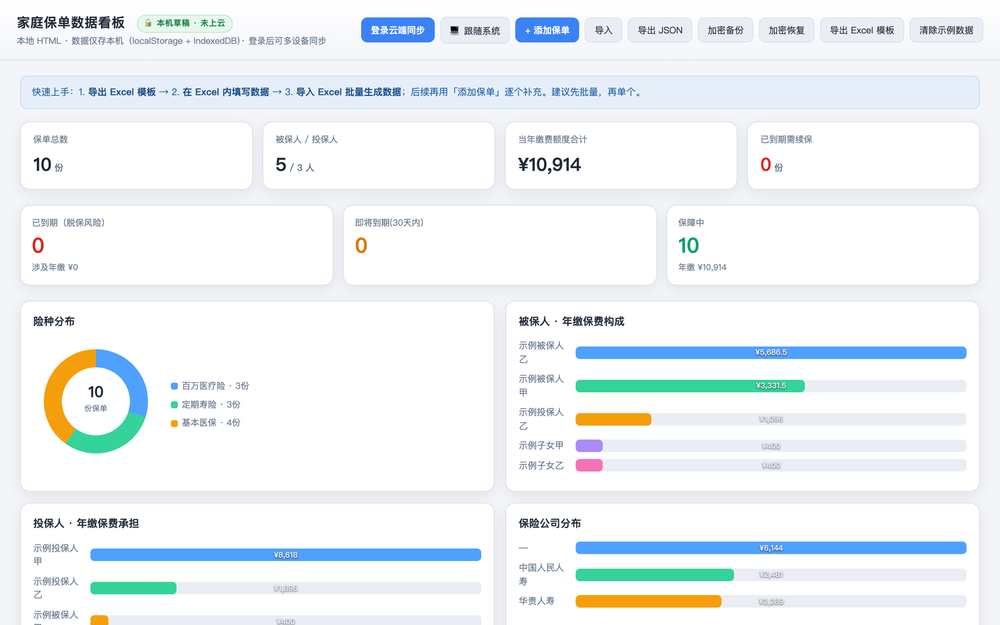

# 家庭保单数据看板

家里买了哪些保险，一张表说清楚：谁在保、保额够不够、哪张快到期、今年一共要交多少钱。

[English](./README.en.md)



## 这是什么

一个**放在自己家里跑**的单页保单看板。保单信息只存在你自己的浏览器里（localStorage / IndexedDB），也可以接自己的 Supabase 做多设备同步；不注册账号、不连第三方服务、不把你的保单传给任何人。

适合这样的人：家里保单分散在几个柜子里、几张 Excel 里，想知道「到底买了什么、还缺什么」，但又不想把身份证、合同、保费交给一个陌生网站。

## 能做什么

- **保单明细表**：按险种、被保险人、保险公司、状态筛选与搜索，支持排序和自定义行顺序。
- **保障与费用汇总**：KPI 卡片给出保单数、总保额、年度保费；环形图与柱状图按被保险人、投保人、保险公司拆解。
- **到期提醒**：近期续费在页头横幅提示，续费统计单独成块。
- **Excel 模板导出 / 导入**：导出内置模板填写后再导回来，保单明细与汇总立即刷新；也支持直接「添加保单」。
- **本机加密备份与恢复**：把数据导出成加密文件，换浏览器或重装前先留一份；恢复时用同一口令解回。
- **主题三态**：深色、浅色、跟随系统，选择记在浏览器里。
- **响应式**：宽屏铺满，窄屏不出现页面级横向滚动。
- **可选云同步**：填入自己的 Supabase 项目地址与公开 Key 后，多设备共享同一份数据。

## 怎么跑起来

### 方式一：Docker（推荐，家里长期挂着）

```bash
# 1) 准备公开配置（只有 Supabase 的 url 与 publishable key，属于可进浏览器的公开值）
cp src/config.example.js src/config.js
#    不接云同步时也必须有这个文件，否则镜像构建会直接失败（这是故意的）

# 2) 构建并启动
docker compose up -d --build

# 3) 打开
open http://localhost:3200/
```

端口由 `.env` 的 `APP_PORT` 控制（默认 3200），镜像标签由 `IMAGE_TAG` 控制，方便回滚到上一版。

### 方式二：任意静态服务器

整个产品就是一个 HTML 文件加一份云同步脚本，不需要 Node 运行时：

```bash
python3 -m http.server 3200 --directory src
open http://localhost:3200/family-insurance-dashboard.html
```

## 数据与隐私

- 业务数据默认只写浏览器本地；容器内不落任何业务文件，也不挂数据卷。
- `src/config.js` 已在 `.gitignore` 里，不会进 Git；`service_role`、数据库密码等私密值不得写进本目录任何文件。
- 仓库与文档只用脱敏示例或合成数据，真实身份证号、合同、保费从不入库。
- 本工具只做记录与汇总，不提供投保建议，也不做核保判断。

## 已知限制

- 本机模式的数据跟着浏览器走：清缓存、换设备前请先导出加密备份。
- 云同步需要你自己的 Supabase 项目，并按仓库内的数据库规范建表；不配也能单机使用。
- 目前没有多用户与权限体系，适合家庭内部自托管，不建议直接暴露到公网。

## 目录

```text
src/
  family-insurance-dashboard.html   # 产品本体（单文件）
  config.example.js                 # 云同步公开配置样例
  repository/                       # 云同步客户端与队列
docker/env.template                 # 部署环境变量模板
compose.yaml / Dockerfile           # 自托管启动方式
docs/                               # 计划、验收、交接与治理记录
```

治理与开发流程见 `AGENTS.md`；当前需求与验收标准见 `docs/pm/PLAN.md`。
